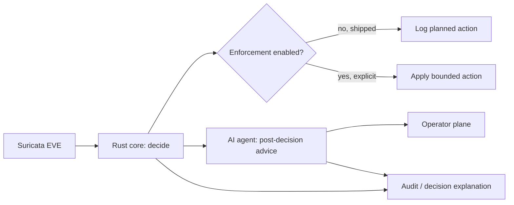

# AZ-01 Azazel-Edge - Deterministic Edge SOC/NOC Gateway

> **Codename:** `SENTINEL`


[](https://github.com/01rabbit/Azazel-Edge/actions/workflows/ci.yml)
[](https://github.com/01rabbit/Azazel-Edge/releases)
[](LICENSE)
[](docs/INDEX.md)


[](https://www.blackhat.com/)

Azazel-Edge is the AZ-01 core platform of the Azazel system, a Raspberry Pi-oriented deterministic edge SOC/NOC gateway and Cyber Scapegoat Gateway for constrained, temporary, and high-risk networks.

It observes local network evidence (Suricata EVE), and the Rust defense core (`azazel-edge-core`) decides a bounded action from it and, only when enforcement is explicitly enabled, applies it. Operator-visible explanations and audit traces are recorded for each decision.

Optional local AI assist runs after the deterministic decision. It may summarize or explain the result, but it does not decide or enforce anything.

Azazel-Edge is not a production SIEM replacement, not an autonomous AI defender, and not a promise of complete attack prevention.

For safe checkout checks, see [Development Verification](#development-verification). The device installer below changes system, network, storage, and optional model-runtime state.

**Who this is for:** security operators, field defenders, incident responders, training teams, and researchers working with constrained local networks.

2025 -> 2026 evolution line:
- `Deployable` focus (rapid portable edge setup) -> `Auditable` focus (explainable deterministic decisions, rejected alternatives, and reviewable trace evidence)

## Responsibility Split

| Component | Role today |
|---|---|
| Rust core (`rust/azazel-edge-core`, `azazel-edge-core.service`) | The live decision and enforcement path. It reads Suricata EVE, selects the action (`decide_defense()`), and applies it only when enforcement is enabled (`maybe_enforce()`). It releases leases on expiry. |
| Python `ActionArbiter` (`py/azazel_edge/arbiter/`) | A deterministic decision record for scenario replay, benchmarks and the SOC policy dry run. No running service applies its output. |
| AI agent (`azazel-edge-ai-agent.service`, `py/azazel_edge_ai/`) | Receives each event after the core has decided. It records the decision, computes the tactical score and second-pass SOC evaluation, and writes advisory text. It cannot change the action. |
| M.I.O. cognitive core (`py/azazel_edge/mio/`) | Shadow and replay only. Run by offline tools (`bin/azazel-mio-shadow-replay`, `bin/azazel-mio-evaluate`, `bin/azazel-mio-trace-export`); no systemd unit starts it. Its recommendations are never executable. |
| Control daemon and Web UI | Display, operator controls and fixed control actions. The core never reads their state. |

Automatic actions can observe, notify and apply temporary flow-scoped throttling. Redirection to a prepared decoy is allowed in `semi-auto` only when high-impact automation is enabled, and in `full-auto`. `isolate` is not an automatic action.

The live M.I.O. auxiliary runs in the AI agent path (`py/azazel_edge_ai/`) and remains advisory. It is distinct from the offline M.I.O. cognitive core in the row above.

Full authority matrix: [M.I.O. Cognitive Plane](docs/architecture/mio-cognitive-plane.md).

## Requirements

| Requirement | Detail |
|---|---|
| Hardware | Raspberry Pi-oriented; tested/developed for constrained edge deployment |
| OS | Raspberry Pi OS / Linux |
| Runtime | Python 3.11 or later (CI tests 3.11; Raspberry Pi OS trixie, the device target, ships 3.13), Rust core components |
| Network | Local edge segment with optional Suricata/OpenCanary integration |
| Optional | Ollama (local AI model runtime), Mattermost, Wazuh, Vector, Aggregator |

## Shipped Defaults

The values below are the shipped systemd unit-file values declared with `Environment=` in [`systemd/azazel-edge-core.service`](systemd/azazel-edge-core.service). The unit also loads `/etc/default/azazel-edge-security` through `EnvironmentFile=`, and settings from that file override the unit's `Environment=` values on a device. The effective values on a given device can therefore differ from this table. Verify dry-run behavior with the [Hardware First-Run Checklist](docs/HARDWARE_FIRST_RUN_CHECKLIST.md).

The table is not exhaustive; the unit declares other variables as well.

| Setting | Shipped unit-file value | Meaning |
|---|---|---|
| `AZAZEL_DEFENSE_ENFORCE` | `false` | No network change is applied |
| `AZAZEL_DEFENSE_DRY_RUN` | `true` | Planned actions are logged only |
| `AZAZEL_DEFENSE_ENFORCE_LEVEL` | `advisory` | Advisory policy level; enforcement is separately gated by `AZAZEL_DEFENSE_ENFORCE` and `AZAZEL_DEFENSE_DRY_RUN` |
| `AZAZEL_DEFENSE_ACTION_TTL_SEC` | `300` | Lifetime in seconds of a defense action lease |
| `AZAZEL_DEFENSE_ALLOW_HIGH_IMPACT_AUTO` | `false` | High-impact actions are not taken automatically |

Enabling enforcement is a deliberate deployment change that must be verified in dry run first. Changing these settings is outside this README's scope; for the configuration reference, see [Configuration Reference](docs/CONFIGURATION.md).

## Development Verification

These checks need no root, network-namespace setup, or device. Installing the pinned dependencies requires GitHub network access. The commands match CI's `test-python` and `test-rust` jobs. The `python -m compileall` line is the Python compile check, which CI runs earlier in its `lint-python` job:

```bash
python3 -m venv .venv
. .venv/bin/activate
pip install -U pip wheel setuptools
pip install -r requirements/runtime.txt
pip install -r requirements/fabric.txt   # fetches a pinned Git tag from GitHub
pip install pytest
find bin -maxdepth 1 -type f -exec chmod +x {} +
python -m compileall -q py azazel_edge_web
node tests/touch_console_logic.test.js
node tests/sentinel_console_logic.test.js
PYTHONPATH=.:py pytest -q
cd rust/azazel-edge-core && cargo test
```

- `requirements/fabric.txt` is an optional extra. Without it, Fabric integrations are guarded no-ops and the deterministic path is unchanged. CI installs it so the shadow/replay contract tests run on every change.
- The `node` tests need Node 20 (the version CI uses). Without Node, the Python wrappers skip them.
- The Suricata, service-objective, network-namespace and non-root CI jobs require root or a Suricata install. They are CI-only and are not part of the safe local checks above.
- Results from these commands are runner or workstation results. They are not hardware evidence.

## Quick Start: System-Changing Device Deployment (sudo)

> **This command changes the system.** It is for a dedicated Raspberry Pi, run as root from a console or `tmux`, not for a workstation. Read the [Physical Setup Guide](docs/PHYSICAL_SETUP_GUIDE.md) first.

```bash
cd /home/azazel/Azazel-Edge
sudo ENABLE_INTERNAL_NETWORK=1 \
     ENABLE_APP_STACK=1 \
     ENABLE_AI_RUNTIME=1 \
     ENABLE_DEV_REMOTE_ACCESS=0 \
     WIFI_COUNTRY=JP \
     bash installer/internal/install_all.sh
```

What this run does to the device:
- **Interactive encrypted-secret setup.** The app stack's security step creates an encrypted secrets volume by default (unless `SKIP_LUKS=1`). It prompts for a passphrase on the terminal. On first install, when the volume is absent, the installer stops if there is no terminal; `SKIP_LUKS=1` must be set explicitly to skip the volume.
- **Network changes.** It builds the internal LAN bridge (`br0`) and its access point. Building `br0` drops an SSH session over `eth0` or `wlan0`, so run it on the console or in `tmux`. On a Raspberry Pi 5, the uplink needs a USB Ethernet or USB Wi-Fi adapter. `WIFI_COUNTRY` is required unless a Wi-Fi country is already set. The `WIFI_COUNTRY=JP` in the command above is an example; change it to your deployment country's code. The AP passphrase is generated and saved root-only in `/etc/azazel-edge/internal-ap.psk`.
- **Packages.** It installs system packages with `apt-get` (including Rust tooling) and builds the Rust core.
- **Model download.** With `ENABLE_AI_RUNTIME=1`, it starts the Ollama container and pulls `qwen3.5:2b` and `qwen3.5:0.8b` over the network.
- **Selftest.** At the end, it runs `bin/azazel-edge-selftest` and installs a periodic selftest timer. A critical selftest failure exits non-zero and reports that the device is not ready.

Verify on the device after installation:

```bash
sudo systemctl status azazel-edge-web azazel-edge-control-daemon azazel-edge-core --no-pager
bin/azazel-edge-selftest   # the installer runs it as root
```

Detailed install/deploy guidance:
- [Deployment Profiles](docs/DEPLOYMENT_PROFILES.md)
- [Operator Guide](docs/OPERATOR_GUIDE.md)
- [Field Deployment Guide](docs/FIELD_DEPLOYMENT_GUIDE.md)
- [Hardware First-Run Checklist](docs/HARDWARE_FIRST_RUN_CHECKLIST.md)

## Architecture Overview



Replay, benchmark and dry-run paths use the Python `ActionArbiter` instead of the live core.

Full architecture:
- [Core Runtime Architecture (P0)](docs/P0_RUNTIME_ARCHITECTURE.md)
- [M.I.O. Cognitive Plane](docs/architecture/mio-cognitive-plane.md)
- [Decision Loop](docs/architecture/decision-loop.md)
- [Scoped Temporary Actions](docs/architecture/scoped-temporary-actions.md)
- [Deception Routing](docs/architecture/deception-routing.md)
- [Local AI Triage](docs/architecture/local-ai-triage.md)
- [Evidence Model](docs/architecture/evidence-model.md)
- [Interactive Architecture Flow (HTML)](docs/architecture/azazel_edge_arch.html)

## What Azazel-Edge does

- runs a local edge gateway and operations surface
- ingests local telemetry such as Suricata EVE
- evaluates NOC and SOC state through deterministic evaluators
- selects bounded actions in the Rust core
- records explanations, alternatives, and audit traces
- supports replay-safe demos and operator workflows
- optionally uses local AI assist for summaries and triage hints after the decision

## Security Boundary Summary

Azazel-Edge claims:
- local-first deterministic decision support
- explicit bounded actions, with enforcement off by default
- operator-visible explanation and audit traces
- optional AI assist that remains secondary to deterministic control

Azazel-Edge does not claim:
- complete attack prevention
- full SIEM replacement
- autonomous AI defense
- legal or regulatory compliance by itself
- safe deployment without operator understanding

## Documentation Map

Primary entry points:
- [Documentation Index](docs/INDEX.md)
- [Core Runtime Architecture (P0)](docs/P0_RUNTIME_ARCHITECTURE.md)
- [API Reference](docs/API_REFERENCE.md)
- [Configuration Reference](docs/CONFIGURATION.md)
- [Deployment Profiles](docs/DEPLOYMENT_PROFILES.md)
- [Operator Guide](docs/OPERATOR_GUIDE.md)
- [Runbooks](runbooks/)
- [AI Operation Guide](docs/AI_OPERATION_GUIDE.md)
- [Arsenal Demo Profile](docs/ARSENAL_DEMO_PROFILE.md)
- [Privacy and Legal Notes](docs/PRIVACY_AND_LEGAL.md)
- [Changelog](docs/CHANGELOG.md) (latest released version: 0.1.2, 2026-05-17; see also [Release Verification Guide](docs/RELEASE_VERIFICATION_GUIDE.md))

## Concept Profiles

Azazel-Edge is maintained as a single core platform.
Different operational profiles are documented as concept profiles, not forks.

- [Evolution Map](docs/concepts/evolution-map.md)
- [Offline Edge-AI SOC/NOC](docs/concepts/offline-edge-ai-socnoc.md)
- [Deterministic Edge Decision Support](docs/concepts/deterministic-edge-decision-support.md)
- [Auditable Emergency SOC/NOC](docs/concepts/auditable-emergency-socnoc.md)
- [Auditable Edge SOC/NOC](docs/concepts/auditable-edge-socnoc.md)
- [Field-Deployable Scapegoat Gateway](docs/concepts/field-deployable-scapegoat-gateway.md)

Candidate CFP and planning material:
- [Candidate CFP Draft: Auditable Edge SOC/NOC](docs/cfp/blackhat-europe-arsenal-auditable-edge-socnoc.md)
- [Paper: Auditable Edge SOC/NOC Gateway](docs/papers/auditable-edge-socnoc-paper.md)

## Arsenal Demonstrations

Only accepted and public Black Hat Arsenal appearances are recorded here.

- [Black Hat Asia 2026](docs/arsenal/blackhat-asia-2026.md)
- [Black Hat USA 2026](docs/arsenal/blackhat-usa-2026.md)

BHUSA 2026 presenter note:
- [BHUSA 2026 Booth Message](docs/arsenal/bhusa-2026-booth-message.md)

See [Arsenal Demonstration History](docs/arsenal/README.md).

## Repository Layout

| Path | Role |
|---|---|
| `rust/azazel-edge-core/` | Rust defense core: live decision and enforcement |
| `py/azazel_edge/` | Evidence Plane, evaluators, `ActionArbiter` (replay/dry run), explanations, audit, M.I.O. cognitive core (shadow) |
| `py/azazel_edge_control/` | Control daemon and action handlers |
| `py/azazel_edge_ai/` | AI agent integration and M.I.O. assist path (post-decision) |
| `azazel_edge_web/` | Flask backend, dashboard, ops-comm UI |
| `runbooks/` | Runbook registry |
| `concept_profiles/` | Concept-to-configuration mapping layer |
| `demos/concepts/` | Concept-oriented deterministic demo grouping |
| `docs/` | Architecture, concept, operations, and reference documentation |

## Azazel Series

Azazel-Edge (**AZ-01**, codename `SENTINEL`) is one product of the **Azazel** series
("Cyber Scapegoat Gateway"). The series map, naming specification, AZ designations,
and doctrine live in the umbrella repository: [01rabbit/Azazel](https://github.com/01rabbit/Azazel).

Edge-local integration note: Edge is the largest consumer of the shared
[Azazel-Fabric](https://github.com/01rabbit/Azazel-Fabric) contracts (guarded,
emit-alongside, zero behavior change). The Fabric pin in `requirements/fabric.txt`
is a release candidate (`v0.9.0rc4`). The shared M.I.O. source pin in
`requirements/runtime.txt` is an immutable commit, not a release. See
[docs/AZAZEL_COMMON_EDGE_ADAPTER_PLAN.md](docs/AZAZEL_COMMON_EDGE_ADAPTER_PLAN.md).

If `azazel_mio` is not importable, the live M.I.O. auxiliary reports a degraded or unavailable record. It never delays or changes the Edge action.

## License

MIT. See [LICENSE](LICENSE).
